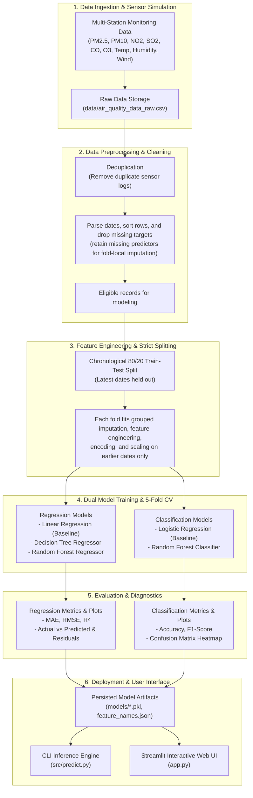

# Air Quality Index (AQI) Prediction and Analysis
### College Mini-Project | Machine Learning Minor

---

> **Important:** The included observations are synthetically generated. AQI is calculated from the same pollutant inputs supplied to the models, so benchmark scores measure how well models recover the generator's rules; they do not establish accuracy on real monitors. The interface estimates an AQI scenario from supplied readings and is not a future forecast or a verified health advisory.

## 1. The Objectives of the Project

Air pollution is an important environmental and public health concern. The primary goal of this college mini-project is to build an end-to-end machine-learning pipeline that analyzes atmospheric criteria pollutants and estimates the **Air Quality Index (AQI)** from supplied measurements.

Rather than treating Machine Learning as a "black box," this project focuses on **showing how we arrived at the solution, how data was cleaned and transformed, why specific algorithms were selected, and how the models compare against one another**.

### Core Project Objectives:
1. **Dual Formulation Modeling:**
   - **Regression Task:** Predict the exact continuous numerical AQI value ($0 - 500+$) using criteria pollutant concentrations and meteorological parameters.
   - **Classification Task:** Classify air quality into standardized health hazard categories (*Good, Satisfactory, Moderate, Poor, Very Poor, Severe*) to trigger actionable health advisories.
2. **Robust Data Preprocessing:** Remove duplicates and fit station-season median imputation, feature engineering, encoding, and scaling only on each training fold.
3. **Domain Feature Engineering:** Derive physically motivated atmospheric indicators, including the fine-particulate ratio ($PM_{2.5} / PM_{10}$), atmospheric ventilation/dispersion proxy, and heat-moisture interaction index.
4. **Algorithmic Benchmarking:** Systematically evaluate parametric baselines (Linear Regression, Logistic Regression) against non-linear tree models (Decision Tree) and bagged ensembles (Random Forest) through 5-Fold Cross-Validation and held-out test evaluation.
5. **Interactive Deployment:** Provide command-line inference and a Streamlit dashboard for scenario estimates and model analysis.

---

## 2. Proposed System, Block Diagram of the Structure

The proposed system adopts a modular, 6-stage machine learning architecture designed to ensure reproducible data flow, prevent data leakage, and provide explainable outputs.

### Architecture Block Diagram:



---

## 3. The Dataset Description

The synthetic dataset generator creates daily records for four named stations (`Station_North`, `Station_South`, `Station_East`, `Station_West`) across two years (2,920 generated observations). The values are illustrative and should not be treated as observations from real monitoring sectors.

### Feature Specification:

| Feature Name | Data Type | Units / Range | Category | Description |
| :--- | :--- | :--- | :--- | :--- |
| `Date` | Datetime | 2023-01-01 to 2024-12-30 | Temporal | Date of generated daily observation |
| `Station` | Categorical | North, South, East, West | Metadata | Geographical monitoring station |
| `Season` | Categorical | Winter, Summer, Monsoon, Post-Monsoon | Atmospheric | Meteorological season |
| `PM2.5` | Continuous | $5.0 - 450.0\ \mu g/m^3$ | Criteria Pollutant | Fine particulate matter ($< 2.5\ \mu m$) from combustion |
| `PM10` | Continuous | $10.0 - 600.0\ \mu g/m^3$ | Criteria Pollutant | Inhalable particulate matter ($< 10\ \mu m$) including dust |
| `NO2` | Continuous | $5.0 - 220.0\ \mu g/m^3$ | Criteria Pollutant | Nitrogen Dioxide from vehicular and industrial combustion |
| `SO2` | Continuous | $2.0 - 80.0\ \mu g/m^3$ | Criteria Pollutant | Sulfur Dioxide from industrial fossil fuel burning |
| `CO` | Continuous | $0.1 - 10.0\ mg/m^3$ | Criteria Pollutant | Carbon Monoxide from incomplete vehicular combustion |
| `O3` | Continuous | $5.0 - 130.0\ \mu g/m^3$ | Secondary Pollutant | Ground-level Ozone formed photochemically with heat/sunlight |
| `Temperature` | Continuous | $5.0 - 48.0\ ^\circ C$ | Meteorological | Ambient dry-bulb temperature |
| `Humidity` | Continuous | $15.0 - 98.0\ \%$ | Meteorological | Relative atmospheric humidity |
| `Wind_Speed` | Continuous | $1.5 - 32.0\ km/h$ | Meteorological | Horizontal surface wind speed |
| **`AQI`** | Continuous | $10.0 - 500.0$ | **Target (Regression)** | Composite Air Quality Index based on sub-index maximum |
| **`AQI_Bucket`** | Categorical | 6 Standard Classes | **Target (Classification)** | Health hazard category based on official CPCB/EPA bands |

### Standard AQI Health Categories:
1. **Good ($0 - 50$):** Minimal health impact; pristine conditions.
2. **Satisfactory ($51 - 100$):** Minor breathing discomfort for sensitive individuals.
3. **Moderate ($101 - 200$):** Discomfort for individuals with asthma or heart conditions.
4. **Poor ($201 - 300$):** Breathing discomfort to most people on prolonged exposure.
5. **Very Poor ($301 - 400$):** Significant respiratory illness; risk for healthy population.
6. **Severe ($401 - 500+$):** Health emergency; serious impact across all demographics.

---

## 4. Info on Data Preprocessing

Data preprocessing removes duplicate records and keeps predictor values missing until a model pipeline is fitted. This lets each validation fold learn its own imputation and scaling values instead of borrowing statistics from its validation period.

### 1. Duplicate Detection and Removal
Environmental telemetry logs occasionally submit re-transmitted network packets. The raw ingestion pipeline identified and eliminated 15 exact duplicate records ($2,935 \to 2,920$ clean records).

### 2. Missing Value Imputation (Fold-Fitted Grouped Median)
Missing values accounted for approximately $2.0\% - 2.9\%$ of entries per column due to simulated sensor downtime, power interruptions, or maintenance cycles.
- **Strategy:** `AQIPreprocessor` learns each sensor's median by `Station` and `Season` from the current training fold, with a training-fold global median as fallback. The same learned medians transform that fold's validation data. After cross-validation, the final model pipeline is refitted on the full training period and applied to the later test period.

```python
# Conceptual flow inside each cloned model pipeline
imputer.fit(training_fold)
X_train_ready = imputer.transform(training_fold)
X_valid_ready = imputer.transform(validation_fold)
```

### 3. Chronological Split and Fold-Safe Transformations
- The final **80% of dates for training** and **latest 20% for testing** are separated chronologically. The current generated dataset yields 2,336 training rows and 584 test rows; the test period begins on 2024-08-07.
- Validation uses expanding chronological windows grouped by date, so all stations on one date stay together.
- Imputation, calendar/domain feature creation, one-hot encoding, and `StandardScaler` live inside an sklearn pipeline. Each cross-validation fold fits them only on its own earlier training dates. The holdout test period is not used to fit these transformations.
- The test period comes from the same synthetic generator. This is a more realistic time split than a random split, but independent real-monitor validation is still needed.

---

## 5. Exploratory Data Analysis (EDA)

Exploratory Data Analysis was performed to discover pollutant distributions, seasonal oscillations, and correlation patterns. All plots are automatically saved in `plots/eda/`.

### Summary Statistics & Skewness:

| Variable | Mean | Std Dev | Min | Median (50%) | Max | Skewness |
| :--- | :--- | :--- | :--- | :--- | :--- | :--- |
| **PM2.5** | $58.63$ | $65.14$ | $5.00$ | $33.77$ | $450.00$ | $+2.30$ (Right-Skewed) |
| **PM10** | $119.51$ | $113.60$ | $10.00$ | $75.74$ | $600.00$ | $+1.99$ (Right-Skewed) |
| **NO2** | $31.49$ | $25.04$ | $5.00$ | $24.76$ | $220.00$ | $+2.46$ (Right-Skewed) |
| **SO2** | $18.15$ | $11.78$ | $2.00$ | $15.52$ | $79.88$ | $+1.22$ (Moderately Skewed) |
| **CO** | $0.94$ | $0.83$ | $0.10$ | $0.71$ | $9.37$ | $+2.76$ (Right-Skewed) |
| **O3** | $25.59$ | $18.45$ | $5.00$ | $22.23$ | $125.67$ | $+1.07$ (Moderately Skewed) |
| **Temperature** | $25.94$ | $8.63$ | $5.00$ | $26.80$ | $47.40$ | $-0.23$ (Symmetric) |
| **Humidity** | $62.51$ | $18.04$ | $15.00$ | $62.70$ | $98.00$ | $-0.08$ (Symmetric) |
| **Wind_Speed** | $12.02$ | $4.72$ | $1.50$ | $12.15$ | $24.10$ | $-0.09$ (Symmetric) |
| **AQI** | $129.76$ | $109.91$ | $17.40$ | $84.00$ | $500.00$ | $+1.50$ (Right-Skewed) |

### Key EDA Insights:
1. **Particulate Matter Dominance:** Both $PM_{2.5}$ and $PM_{10}$ exhibit strong positive skewness with elongated right tails corresponding to severe pollution and smog events.
2. **Correlation Analysis:** Pearson correlation demonstrates that $PM_{2.5}$ ($r \approx 0.94$) and $PM_{10}$ ($r \approx 0.93$) have the strongest correlation with AQI, identifying them as the dominant sub-index criteria.
3. **Atmospheric Ventilation Effect:** Wind speed has a negative correlation with AQI. Higher wind speeds enhance horizontal advection and turbulent dispersion, dispersing accumulated pollutants.
4. **Photochemical Ozone Production:** Ozone ($O_3$) correlates positively with temperature ($r \approx 0.52$), confirming that warm, sunny conditions accelerate volatile organic and $NO_x$ photochemical reactions.
5. **Seasonal Extremes:** Winter exhibits the highest median AQI and widest variance due to surface temperature inversions trapping pollutants close to the ground, while Monsoon exhibits the cleanest air due to precipitation scavenging.

---

## 6. Feature Selection / Engineering

To help machine learning models capture atmospheric physical processes without requiring complex differential equation solvers, we engineered five domain-inspired features:

### 1. Particulate Fine-Fraction Ratio (`PM_Ratio`)

$$
\text{PM Ratio} = \frac{\text{PM}_{2.5}}{\text{PM}_{10}}
$$

- **Physical Meaning:** Differentiates between combustion-driven episodes (high fine-particulate fraction from vehicular exhaust and biomass burning, where ratio $> 0.6$) and windblown crustal dust storms (coarse fraction dominant, where ratio $< 0.4$).

### 2. Dispersion / Ventilation Proxy (`Dispersion_Index`)

$$
\text{Dispersion Index} = \frac{\text{Wind Speed} + 1.0}{\text{PM}_{2.5} + 1.0}
$$

- **Physical Meaning:** Represents the capacity of the atmospheric boundary layer to flush out particulate matter per unit mass concentration (ventilation capacity).

### 3. Atmospheric Heat-Moisture Index (`Heat_Moisture_Index`)

$$
\text{Heat-Moisture Index} = \frac{\text{Temperature} \times \text{Humidity}}{100}
$$

- **Physical Meaning:** Captures air mass stagnation and vapor saturation conditions that foster secondary aerosol nucleation and photochemical reaction rates.

### 4. Temporal Calendar Components (`Month`, `DayOfWeek`, `Is_Weekend`)

- **Physical Meaning:** Captures periodic weekly and seasonal anthropogenic emission cycles (e.g., lower industrial output and altered traffic profiles on weekends).

### 5. Categorical Encodings (Station & Season)

- **Station Indicators:** One-hot encoded categorical dummies (`Station_Station_North`, `Station_Station_South`, `Station_Station_West`) capturing localized emission baselines.
- **Seasonal Indicators:** One-hot encoded dummies (`Season_Post-Monsoon`, `Season_Summer`, `Season_Winter`) capturing synoptic meteorological shifts.

**Final Model Feature Space:** 21 numerical and encoded features.

---

## 7. ML Methodology Used

### Problem Formulation:
We structured the prediction problem into two complementary branches:
1. **Continuous Regression ($y \in \mathbb{R}^+$):** Evaluates how close the estimated AQI number is to the synthetic label.
2. **Multi-Class Classification ($y \in \{0, 1, 2, 3, 4, 5\}$):** Evaluates whether the model assigns the correct health advisory tier, even across non-linear category boundaries.

### Validation Strategy:
- **Held-Out Test Period:** The latest $20\%$ of dates ($N=584$ rows) is reserved for final benchmarking.
- **5-Fold Expanding-Window Cross-Validation:** The training period is divided into five later validation windows. Each model trains on earlier dates and validates on the next window; all stations for a date remain in the same fold. The complete preprocessing pipeline is refit inside every fold.

### Evaluation Metric Selection:
- **Regression:**
  - **Mean Absolute Error (MAE):** Linear penalty; represents average error in AQI points.
  - **Root Mean Squared Error (RMSE):** Quadratic penalty; gives larger AQI estimation errors more weight.
  - **Coefficient of Determination ($R^2$):** Proportion of variance in AQI explained by the features.
- **Classification:**
  - **Accuracy:** Overall proportion of correct category assignments.
  - **Weighted Precision & Recall:** Handles minor class imbalances across severity tiers.
  - **Weighted and Macro F1:** Weighted F1 emphasizes common classes; macro F1 gives each AQI category equal weight.
  - **Per-Class Precision, Recall, F1 and Support:** Shows performance for rare categories such as Severe.
  - **Confusion Matrix:** Inspects misclassification patterns between adjacent categories.

---

## 8. Algorithms Used

We deliberately evaluated and compared models spanning increasing complexity to explain **why and how** each performs on atmospheric tabular data:

### Regression Algorithms:

#### 1. Linear Regression (Baseline Model)
- **Mathematical Form:**

$$
\hat{y} = \beta_0 + \sum_{j=1}^{p} \beta_j X_j
$$

- **Optimization:** Solved via Ordinary Least Squares (OLS) closed-form normal equation: $\hat{\beta} = (X^T X)^{-1} X^T y$.
- **Why We Used It:** Serves as the fundamental interpretable baseline. Helps us see how much of AQI can be approximated as a simple linear combination of pollutants.
- **Limitation:** AQI sub-index calculations are piecewise linear with breakpoint threshold transitions; standard linear regression cannot create sharp threshold slopes and produces larger residuals at boundary points.

#### 2. Decision Tree Regressor (Non-Linear Single Tree)
- **Mathematical Form:** Recursively partitions the feature space into axis-aligned hyper-rectangles $R_m$ that minimize within-node variance (MSE):

$$
\text{MSE}(R_m) = \frac{1}{N_m} \sum_{i \in R_m} (y_i - \bar{y}_m)^2
$$

- **Why We Used It:** Naturally captures if-else threshold rules (e.g., "if $\text{PM}_{2.5} > 120$ and Wind $< 5$, assign Severe").
- **Regularization:** Tuned with `max_depth=6` and `min_samples_split=10` to avoid memorizing noise.
- **Limitation:** Step-function nature creates piecewise flat predictions, producing moderate variance.

#### 3. Random Forest Regressor (Ensemble Bagging)
- **Mathematical Form:** Constructs an ensemble of $B=100$ de-correlated decision trees trained on bootstrap samples of the training data. The final prediction averages individual tree outputs:

$$
\hat{y}_{\text{RF}} = \frac{1}{B} \sum_{b=1}^{B} T_b(X)
$$

- **Why We Used It:** Bagging reduces single-tree variance drastically without increasing bias. Random subspace selection (evaluating random subsets of features at each split) de-correlates trees, making the ensemble resilient to collinearity between $\text{PM}_{2.5}$ and $\text{PM}_{10}$.

---

### Classification Algorithms:

#### 1. Logistic Regression (Multinomial Baseline)
- **Mathematical Form:** Computes class probabilities using the softmax activation function:

$$
P(Y = k \mid X) = \frac{e^{\beta_k^T X}}{\sum_{j=1}^{K} e^{\beta_j^T X}}
$$

- **Why We Used It:** Standard linear classification benchmark that outputs class probability estimates; those estimates are not guaranteed to be calibrated.

#### 2. Random Forest Classifier (Multi-Class Ensemble)
- **Mathematical Form:** Ensemble of classification trees voting on category membership, splitting nodes based on the Gini Impurity metric:

$$
G = 1 - \sum_{k=1}^{K} p_k^2
$$

- **Why We Used It:** Capable of establishing complex, non-linear decision boundaries between adjacent AQI tiers (e.g., Moderate vs. Poor).

---

## 9. Model Training, Validating and Testing

All models were trained on the earlier training period ($N=2,336$), validated using five expanding-window date folds, and evaluated on the later held-out period ($N=584$, beginning 2024-08-07). The included data remains synthetic, so these results are an internal benchmark rather than evidence of field accuracy.

### Execution Summary:
- **Preprocessing:** Grouped imputation, feature engineering, encoding, and scaling are fit within each pipeline fold and refit on the full training period before test evaluation.
- **Cross-Validation Results:**
  - Linear Regression chronological 5-fold $R^2$: $0.8342 \pm 0.1038$
  - Decision Tree chronological 5-fold $R^2$: $0.9303 \pm 0.0584$
  - Random Forest chronological 5-fold $R^2$: $\mathbf{0.9673 \pm 0.0310}$
  - Logistic Regression chronological 5-fold accuracy: $75.58\% \pm 3.95\%$
  - Random Forest Classifier chronological 5-fold accuracy: $\mathbf{89.17\% \pm 6.48\%}$

The larger fold-to-fold spread is informative: later time windows can be harder than earlier ones. It should not be summarized as uniformly stable performance.

---

## 10. Implementation

The project is structured into modular Python packages with clean separation of concerns:

```
AQIPredict/
│
├── README.md                             # Comprehensive project documentation (13 sections)
├── project_prompt.txt                    # College project prompt requirements
├── requirements.txt                      # Pip dependency file (for local setup & Streamlit Cloud)
├── app.py                                # Streamlit Interactive Web Application
│
├── data/
│   ├── generate_dataset.py               # Reproducible multi-station data simulator
│   ├── air_quality_data_raw.csv          # Raw data with injected missingness & duplicates
│   ├── air_quality_data_clean.csv        # Preprocessed clean baseline dataset
│   └── test_predictions.csv              # Test set actuals vs. model predictions
│
├── src/
│   ├── preprocess.py                     # Deduplication, temporal split, fold-fitted preprocessing transformer
│   ├── eda.py                            # Summary statistics and EDA visualizer
│   ├── train_models.py                   # Date-grouped CV, regression & classification metrics
│   ├── visualize_results.py              # Performance plots, residuals, confusion matrices
│   └── predict.py                        # Standalone CLI inference engine with health advisory
│
├── models/
│   ├── aqi_scaler.pkl                    # Legacy standalone scaler; new pipelines bundle preprocessing
│   ├── label_encoder.pkl                 # Target LabelEncoder for AQI categories
│   ├── aqi_regressor_lr.pkl              # Trained Linear Regression model
│   ├── aqi_regressor_dt.pkl              # Trained Decision Tree Regressor
│   ├── aqi_regressor_rf.pkl              # Random Forest pipeline with preprocessing and estimator
│   ├── aqi_classifier_rf.pkl             # Random Forest classification pipeline
│   ├── feature_names.json                # Feature names specification for schema validation
│   └── evaluation_metrics.json           # Serialized numerical evaluation metrics
│
├── plots/
│   ├── eda/                              # EDA figures (distributions, correlation heatmap, etc.)
│   └── results/                          # Evaluation figures (actual vs predicted, residuals, CM)
│
└── notebooks/
    └── aqi_prediction_walkthrough.ipynb  # Interactive Jupyter Notebook for grading & viva
```

### How to Run the Project:

1. **Install Dependencies:**
   ```bash
   pip install -r requirements.txt
   ```

2. **Generate the Dataset (Reproducible):**
   ```bash
   python data/generate_dataset.py
   ```

3. **Run Preprocessing Pipeline:**
   ```bash
   python src/preprocess.py
   ```

4. **Generate Exploratory Data Analysis (EDA) Plots:**
   ```bash
   python src/eda.py
   ```

5. **Train All ML Models & Perform Cross-Validation:**
   ```bash
   python src/train_models.py
   ```

6. **Generate Result Visualizations & Residual Diagnostics:**
   ```bash
   python src/visualize_results.py
   ```

7. **Run CLI Inference with Sample Scenarios:**
   ```bash
   python src/predict.py
   ```

8. **Launch the Interactive Streamlit Web Dashboard:**
   ```bash
   streamlit run app.py
   ```

---

## 11. Model Evaluation

### 1. Regression Models Benchmark (Target: Continuous `AQI`)

| Model | Chronological CV $R^2$ ($\mu \pm \sigma$) | Train $R^2$ | Later-Period Test $R^2$ | Test RMSE | Test MAE | Performance Ranking |
| :--- | :---: | :---: | :---: | :---: | :---: | :---: |
| **Linear Regression** | $0.8342 \pm 0.1038$ | $0.9488$ | $0.9424$ | $27.80$ | $20.56$ | Baseline |
| **Decision Tree Regressor** | $0.9303 \pm 0.0584$ | $0.9935$ | $0.9742$ | $18.59$ | $7.99$ | Strong Non-Linear |
| **Random Forest Regressor** | $\mathbf{0.9673 \pm 0.0310}$ | $\mathbf{0.9985}$ | $\mathbf{0.9812}$ | $\mathbf{15.87}$ | $\mathbf{4.37}$ | **Best Model in this benchmark** |

#### Key Regression Observations:
- **Random Forest:** It leads this later-period synthetic benchmark with $R^2=0.9812$ and MAE $=4.37$ AQI points. These scores are not real-monitor accuracy claims because AQI labels are generated from the predictor pollutants.
- **Linear Regression:** Its MAE is $20.56$ and RMSE is $27.80$, consistent with a linear baseline struggling to represent the generator's nonlinear thresholds.
- **Time variation:** Chronological CV has more fold-to-fold variation than random CV; this is expected to reveal time-window shifts and should be reported rather than hidden.

---

### 2. Classification Models Benchmark (Target: `AQI_Bucket`)

| Model | Chronological CV Accuracy | Test Accuracy | Weighted F1 | Macro F1 |
| :--- | :---: | :---: | :---: | :---: |
| **Logistic Regression** | $75.58\% \pm 3.95\%$ | $89.04\%$ | $0.8899$ | $0.8816$ |
| **Random Forest Classifier** | $\mathbf{89.17\% \pm 6.48\%}$ | $\mathbf{95.03\%}$ | $\mathbf{0.9503}$ | $\mathbf{0.9413}$ |

#### Key Classification Observations:
- Random Forest Classifier achieved **$95.03\%$ later-period test accuracy**, with weighted F1 $0.9503$ and macro F1 $0.9413$.
- Per-class scores matter because test support is imbalanced. Random Forest's *Severe* recall is $0.8333$ on 18 examples; the score is less certain than the larger classes' results.
- The later test period is still generated by the same simulator, so improved time splitting does not replace evaluation on independent CPCB or local sensor observations.

| AQI category | Precision | Recall | F1 | Test support |
| :--- | :---: | :---: | :---: | :---: |
| Good | 0.9837 | 0.9680 | 0.9758 | 125 |
| Moderate | 0.9306 | 0.9437 | 0.9371 | 142 |
| Poor | 0.9074 | 0.9245 | 0.9159 | 53 |
| Satisfactory | 0.9568 | 0.9568 | 0.9568 | 162 |
| Severe | 1.0000 | 0.8333 | 0.9091 | 18 |
| Very Poor | 0.9419 | 0.9643 | 0.9529 | 84 |

---

## 12. Graphical Representation of Results

High-resolution visual representations of the evaluation results were automatically plotted and saved to `plots/results/`:

### 1. Actual vs. Predicted AQI Regression Plots
- **File:** `plots/results/actual_vs_predicted_regression.png`
- **Analysis:** Compares all three regression models against the ideal $y = x$ reference diagonal. Linear Regression displays visible scattering at both low and high extremes. In contrast, Random Forest aligns tightly along the diagonal throughout the entire $0 - 500$ index range.

### 2. Residual Error Analysis & Homoscedasticity Check
- **File:** `plots/results/residual_analysis.png`
- **Analysis:**
  - **Residual Histogram:** Shows the distribution of later-period AQI errors around zero; inspect asymmetry and long tails for systematic or unusually large errors.
  - **Residuals vs. Predicted Plot:** Helps reveal prediction ranges where errors become larger or systematically biased. These plots do not by themselves prove unbiasedness or constant variance.

### 3. Regression Model Performance Comparison
- **File:** `plots/results/regression_model_comparison.png`
- **Analysis:** Side-by-side comparison of later-period $R^2$ ($0.9424 \to 0.9742 \to 0.9812$) and RMSE ($27.80 \to 18.59 \to 15.87$) across the models.

### 4. Multi-Class Confusion Matrix Heatmap
- **File:** `plots/results/confusion_matrix_classifier.png`
- **Analysis:** The confusion matrix shows correct and mistaken classifications for each category on the later-date test set; inspect it alongside per-class precision, recall, F1, and support.

### 5. Classification Performance Comparison
- **File:** `plots/results/classification_model_comparison.png`
- **Analysis:** Direct bar chart comparison of accuracy and weighted F1 for both classifiers on the later-date test set.

### 6. Feature Importance Ranking
- **File:** `plots/results/feature_importance_ranking.png`
- **Analysis:** Impurity-based regression-forest importance ranks PM2.5 first (about 84.4%) and PM10 second (about 14.0%). In the classifier, PM10 (about 26.7%), PM2.5 (22.4%), and Dispersion_Index (13.4%) lead. These are split-importance scores, not causal effects; particulate dominance is expected because the generator uses pollutant sub-indices to create AQI.

---

## 13. Conclusion

This project implements an end-to-end machine-learning pipeline for AQI scenario estimation and category classification. It uses synthetic data, so the results demonstrate the workflow rather than validate an operational air-quality service.

### Key Conclusions:
1. **How We Arrived at the Solution:**
   - Started from atmospheric physics and environmental standards (CPCB/EPA sub-index breakpoints).
   - Modeled the estimation task with both numeric regression and six-category classification.
2. **How Data Was Used & Cleaned:**
   - Station-season medians, feature engineering, one-hot encoding, and scaling are fit inside each cross-validation pipeline, then refit on training dates before test evaluation.
   - A chronological holdout uses the latest dates for testing, and expanding folds keep station records from the same date together.
   - Domain feature engineering (such as $PM_{2.5}/PM_{10}$ ratio and ventilation index) provides additional input signals.
3. **Why Specific Algorithms Succeeded:**
   - **Linear models** provide fast baselines but lag behind tree ensembles on this generated rule set.
   - **Random Forest** leads the time-based synthetic benchmark (test $R^2=0.9812$, MAE $=4.37$; classification accuracy $=95.03\%$, macro F1 $=0.9413$).
   - Per-class reporting shows Random Forest Severe recall of $0.8333$ on 18 test examples, which overall accuracy alone would obscure.
4. **Practical Application:**
   - The CLI and Streamlit app accept supplied readings and return scenario estimates. Their outputs are not future forecasts or verified health advisories.
5. **Next Validation Step:**
   - Replace or supplement the generated data with independent real-monitor observations before making claims about field performance.

---
*Developed for College Mini-Project (Machine Learning Minor).*
