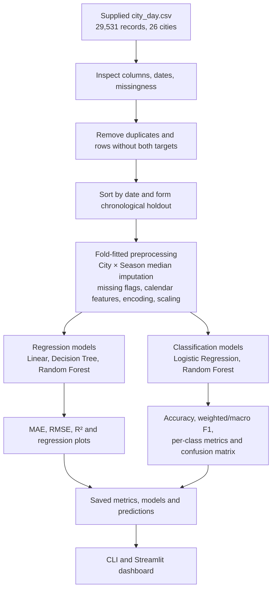

# Air Quality Index (AQI) Prediction and Analysis
### College Mini-Project | Machine Learning Minor

---

> **Scope:** This project estimates AQI and its category from same-day pollutant readings in the supplied historical city-day dataset. The file does not include a data dictionary or source provenance. Results measure agreement with its AQI labels in a later date period; they do not validate an official AQI calculation, a live monitoring service, a future forecast, or health advice.

## 1. The Objectives of the Project

Air pollution is an important environmental and public health concern. The goal of this college mini-project is to build an end-to-end machine-learning pipeline that studies pollutant observations and estimates the **Air Quality Index (AQI)** and the category label supplied with each record.

The project also documents how the data is prepared, how models are compared, and where the current results have limits.

### Core Project Objectives

1. **Dual prediction tasks**
   - **Regression:** estimate the numeric `AQI` value from the supplied city, date, and pollutant readings.
   - **Classification:** estimate the supplied `AQI_Bucket` category: Good, Satisfactory, Moderate, Poor, Very Poor, or Severe.
2. **Leakage-aware preprocessing:** retain missing pollutant readings until each training fold fits its own imputation, encoding, and scaling steps.
3. **Exploratory analysis:** summarize distributions, missingness, seasonal patterns, and pollutant-to-AQI correlations.
4. **Algorithm comparison:** compare linear baselines with decision-tree and random-forest models using time-ordered validation and a later-date holdout.
5. **Usable outputs:** provide saved model pipelines, analysis plots, a command-line example, a notebook, and a Streamlit dashboard.

---

## 2. Proposed System and Block Diagram

The project uses a modular six-stage workflow. Every validation fold fits its transformations on earlier dates only, and all city records for one date remain together in the same split.



---

## 3. The Dataset Description

The active input is [`data/city_day.csv`](data/city_day.csv), the city-day file supplied for this project. It has **29,531 records**, **26 cities**, and dates from **2015-01-01 to 2020-07-01**. There are no exact duplicate rows. Both `AQI` and `AQI_Bucket` are present for **24,850 records**; records missing either target are excluded from the joint supervised comparison.

The file contains 16 columns. It does not specify pollutant units, AQI calculation conventions, or source provenance. The maximum supplied AQI is **2,049**. Values are retained as provided; they are not clipped to a standard range.

| Field | Role | Notes |
| :--- | :--- | :--- |
| `City` | Input metadata | 26 city names; normalized as text before modeling |
| `Date` | Input time field | 2015-01-01 to 2020-07-01; also used to form chronological partitions |
| `PM2.5`, `PM10` | Pollutant inputs | Numeric readings; units are not specified in the supplied file |
| `NO`, `NO2`, `NOx`, `NH3` | Pollutant inputs | Numeric readings; units are not specified in the supplied file |
| `CO`, `SO2`, `O3` | Pollutant inputs | Numeric readings; units are not specified in the supplied file |
| `Benzene`, `Toluene`, `Xylene` | Pollutant inputs | Numeric readings; Xylene is excluded from the primary models due to missingness |
| `AQI` | Target for regression | Continuous label supplied in the file; observed range 13 to 2,049 among labeled rows |
| `AQI_Bucket` | Target for classification | Supplied category: Good, Satisfactory, Moderate, Poor, Very Poor, or Severe |
| `Season` | Derived field | Created from `Date`; not present as a source column |

### Missingness in the Supplied File

| Column | Missing (%) | Column | Missing (%) |
| :--- | ---: | :--- | ---: |
| PM2.5 | 15.6 | PM10 | 37.7 |
| NO | 12.1 | NO2 | 12.1 |
| NOx | 14.2 | NH3 | 35.0 |
| CO | 7.0 | SO2 | 13.1 |
| O3 | 13.6 | Benzene | 19.0 |
| Toluene | 27.2 | Xylene | 61.3 |
| AQI | 15.9 | AQI_Bucket | 15.9 |

The original synthetic-data files and generator remain in `data/` for reference. The current training pipeline reads `city_day.csv` instead.

---

## 4. Info on Data Preprocessing

Preprocessing converts the supplied file into model-ready records while keeping each fold's validation period separate from the statistics learned on its training period.

### 1. Basic Validation and Cleaning
- Check for required fields (`City`, `Date`, `AQI`, and `AQI_Bucket`) and remove exact duplicate rows.
- Parse dates, trim city and category text, convert pollutant and AQI fields to numeric, and treat non-finite numbers as missing.
- Remove rows with invalid dates, missing cities, or a missing AQI target or category. Keep only the six category names present in the project label mapping.

### 2. Missing Pollutant Values
- Xylene is omitted from the primary model inputs because **61.3%** of its values are missing.
- The other 11 pollutant columns are kept with their missing values. For each pollutant, `AQIPreprocessor` learns a **City × Season median** from the current training fold, then uses that fold's overall pollutant median when no group value is available.
- A missing-value indicator is created for every modeled pollutant before imputation, so the model can distinguish an imputed reading from an observed one.
- Validation and test observations never contribute to the learned imputation values.

```text
Fit on an earlier training fold:
  learn city-season and global medians
  learn feature scaling values

Transform the next validation fold:
  apply the saved medians and scaling values
```

### 3. Calendar Features and Encoding
- Derive Winter (December–February), Summer (March–May), Monsoon (June–September), or Post-Monsoon (October–November) from the date.
- Add month, day of week, and weekend indicators.
- One-hot encode City and Season, then standardize the resulting features.
- Keep imputation, feature creation, encoding, and scaling together inside each model pipeline, so cross-validation refits them within every fold.

### 4. Chronological Holdout
The latest **20% of distinct labeled dates** are held out. The test period begins on **2019-05-27** and contains **8,832 rows**; the earlier training period contains **16,018 rows**. These row counts are not an 80/20 ratio because the number of cities represented varies by date. All rows with the same date stay in one partition.

---

## 5. Exploratory Data Analysis (EDA)

EDA summarizes the labeled records before modeling. The scripts save plots and supporting tables under `plots/eda/`.

### Selected Summary Statistics

| Variable | Mean | Median | Maximum | Skewness |
| :--- | ---: | ---: | ---: | ---: |
| PM2.5 | 67.48 | 48.79 | 914.94 | 2.96 |
| PM10 | 118.45 | 96.18 | 917.08 | 1.93 |
| NO2 | 28.98 | 22.10 | 362.21 | 2.44 |
| CO | 2.35 | 0.93 | 175.81 | 8.63 |
| AQI | 166.46 | 118.00 | 2,049.00 | 3.40 |

### Key EDA Findings
1. **Uneven pollutant coverage:** PM10 and NH3 are missing in over one-third of the raw rows; Xylene is missing in 61.3%.
2. **Pollutant associations:** among labeled records, AQI has the strongest Pearson correlation with PM10 (`r = 0.803`), followed by CO (`r = 0.683`) and PM2.5 (`r = 0.659`). Correlation describes association, not causation.
3. **Seasonal pattern:** the observed median AQI is 171 in calendar-derived Winter and 89 in Monsoon. City and date coverage differ across the dataset and can contribute to this pattern.
4. **Skew and extremes:** pollutant distributions are right-skewed, and AQI includes values above 500. Summary metrics and plots should be interpreted with those extremes in mind.
5. **Label frequency:** Moderate and Satisfactory are the most common supplied categories. Category-level scores are included with overall classification metrics.

---

## 6. Feature Selection and Engineering

This version does not perform a separate statistical feature-selection procedure. It chooses inputs based on the available columns and missingness, then records the features generated by the fitted preprocessing pipeline.

### 1. Pollutant Inputs
Eleven measured fields are used: PM2.5, PM10, NO, NO2, NOx, NH3, CO, SO2, O3, Benzene, and Toluene. Xylene is excluded from the primary models due to 61.3% missingness.

### 2. Missingness Indicators
For each modeled pollutant, a binary `*_WasMissing` field records whether the original input was absent before fold-fitted imputation.

### 3. Calendar and Location Features
- `Month`, `DayOfWeek`, and `Is_Weekend` represent calendar timing.
- `City_*` and `Season_*` one-hot fields represent the city and date-derived season.

**Final feature space:** the fitted training pipeline emits **46 features** for the current chronological split. Feature importance plots are model diagnostics; they are not a causal analysis or an independent feature-selection stage.

---

## 7. ML Methodology Used

### Problem Formulation
1. **Regression:** predict continuous `AQI` from City, Date, and the 11 selected pollutants.
2. **Classification:** predict the supplied `AQI_Bucket` category from the same inputs.

The two targets are modeled separately. AQI category is not recalculated from the regression output.

### Validation Strategy
- **Later-date holdout:** latest 20% of distinct labeled dates, beginning 2019-05-27.
- **Five-fold expanding-window cross-validation:** each validation block contains later dates than its training data; all records on a date remain in one block.
- Every preprocessing step is fit inside the model pipeline on each training fold. The held-out period is not used to select the Random Forest class weights; class weighting was compared using training-period macro-F1 folds.

### Evaluation Metrics
- **Regression:** MAE measures average absolute error in AQI points; RMSE penalizes larger errors more strongly; R² compares explained variance with a mean-only baseline.
- **Classification:** accuracy measures the fraction of correct labels; weighted F1 reflects class frequency; macro F1 gives each category equal weight. Per-class precision, recall, F1, support, and a confusion matrix show where errors occur.

---

## 8. Algorithms Used

The project compares linear baselines, a single decision tree, and random-forest ensembles. The equations below summarize the fitted model families.

### Regression Algorithms

#### 1. Linear Regression

$$
\hat{y} = \beta_0 + \sum_{j=1}^{p}\beta_j x_j
$$

The model fits coefficients by minimizing squared residuals, `Σ(yᵢ − ŷᵢ)²`. It provides a simple baseline and is easy to inspect, but a single linear equation cannot represent every nonlinear interaction in the data.

#### 2. Decision Tree Regressor

At each split, the tree chooses a partition that reduces within-leaf squared error. For leaf region `Rₘ`:

$$
\operatorname{MSE}(R_m) = \frac{1}{N_m}\sum_{i \in R_m}(y_i - \bar{y}_m)^2
$$

The tree captures threshold rules and nonlinear patterns without requiring feature scaling for its splits. The project limits it to `max_depth=6` with `min_samples_split=10` to constrain complexity. A single tree can still vary substantially with the training data.

#### 3. Random Forest Regressor

The forest fits 100 trees to bootstrap samples and averages their predictions:

$$
\hat{y}_{\mathrm{RF}}(x) = \frac{1}{B}\sum_{b=1}^{B}T_b(x),\quad B=100
$$

Random feature subsets decorrelate trees, while averaging reduces the variance of an individual tree. The current estimator uses `max_depth=12` and `min_samples_split=5`.

### Classification Algorithms

#### 1. Logistic Regression

For `K` classes, the multinomial model applies softmax to class scores:

$$
P(Y=k\mid x) = \frac{e^{\beta_k^T x}}{\sum_{j=1}^{K} e^{\beta_j^T x}}
$$

It is a linear classification baseline and produces class probabilities. The project uses `max_iter=1000`; the output probabilities are not calibrated.

#### 2. Random Forest Classifier

The classifier combines 100 decision trees and predicts the class with the most votes. Tree splits use Gini impurity:

$$
G = 1 - \sum_{k=1}^{K}p_k^2
$$

Its current estimator uses `max_depth=12`, `min_samples_split=5`, and `class_weight="balanced"`. The class weights give less frequent training categories more influence. Their use was retained based on training-period macro-F1 validation.

---

## 9. Model Training, Validating, and Testing

1. Read `data/city_day.csv`, inspect data quality, and retain labeled rows for the two supervised tasks.
2. Reserve the later-date holdout before fitting model pipelines.
3. Compare three regression and two classification pipelines using the same fold-local preprocessing.
4. Use five expanding date folds for model validation. Classification cross-validation reports both accuracy and macro F1.
5. Fit each final estimator on the complete training period and evaluate it once on the held-out later dates.
6. Save model pipelines, feature names, metrics, and test predictions under `models/` and `data/`.

The test rows come later in time but from the same 26-city collection. This tests temporal transfer within the supplied file; it does not replace validation on unseen cities or independent monitoring data.

---

## 10. Project Structure and How to Run

```text
AQIPredict/
├── app.py                                  # Streamlit interface for same-day estimates and analysis
├── data/
│   ├── city_day.csv                        # Supplied active dataset
│   ├── air_quality_data_clean.csv          # Labeled rows and derived season, regenerated by training
│   ├── test_predictions.csv                # Later-date holdout targets and predictions
│   └── generate_dataset.py                 # Legacy synthetic-data generator; not used by training
├── models/
│   ├── aqi_regressor_lr.pkl                 # Preprocessing pipeline + Linear Regression
│   ├── aqi_regressor_dt.pkl                 # Preprocessing pipeline + Decision Tree Regressor
│   ├── aqi_regressor_rf.pkl                 # Preprocessing pipeline + Random Forest Regressor
│   ├── aqi_classifier_rf.pkl                # Preprocessing pipeline + balanced Random Forest Classifier
│   ├── label_encoder.pkl                    # Mapping between category names and model labels
│   ├── evaluation_metrics.json              # Cross-validation, holdout, and per-class metrics
│   └── feature_names.json                   # Names emitted by the fitted preprocessing pipeline
├── notebooks/
│   ├── aqi_prediction_walkthrough.ipynb     # Guided walkthrough
│   └── generate_notebook.py                 # Rebuild the walkthrough notebook
├── plots/
│   ├── eda/                                 # Distributions, missingness, correlations, and seasonality
│   └── results/                             # Regression/classification diagnostics and importance
└── src/
    ├── preprocess.py                        # Cleaning, chronological split, fold-fitted transformer
    ├── train_models.py                      # Model fitting, date CV, metrics, and artifact export
    ├── eda.py                               # Dataset summary and EDA figures/tables
    ├── visualize_results.py                 # Holdout comparisons and diagnostics
    └── predict.py                           # CLI estimate using saved model pipelines
```

### Run the Project

1. **Install dependencies**
   ```bash
   pip install -r requirements.txt
   ```
2. **Train the models and recreate cleaned data, metrics, and holdout predictions**
   ```bash
   python src/train_models.py
   ```
3. **Create EDA and model-result plots**
   ```bash
   python src/eda.py
   python src/visualize_results.py
   ```
4. **Try the command-line example**
   ```bash
   python src/predict.py
   ```
5. **Launch the interactive dashboard**
   ```bash
   streamlit run app.py
   ```

The dashboard and CLI return same-day estimates from supplied City, Date, and pollutant readings. They do not generate future forecasts or official AQI or health determinations. The displayed classifier probabilities are not calibrated.

---

## 11. Model Evaluation

The following results come from the held-out dates beginning 2019-05-27. Cross-validation scores were calculated from training-period dates only. Values are reproduced in `models/evaluation_metrics.json`.

### 1. Regression Models (`AQI`)

| Model | CV R² (mean ± SD) | Train R² | Test R² | Test RMSE | Test MAE |
| :--- | :---: | :---: | :---: | :---: | :---: |
| Linear Regression | 0.7657 ± 0.0501 | 0.8456 | 0.8075 | 45.61 | 32.55 |
| Decision Tree Regressor | 0.7446 ± 0.0790 | 0.8934 | 0.8658 | 38.08 | 22.34 |
| **Random Forest Regressor** | **0.8196 ± 0.0394** | **0.9596** | **0.9051** | **32.03** | **17.68** |

The Random Forest leads this benchmark on the later-date test set. Its test MAE is about 17.68 AQI points and its R² is 0.9051. These values describe agreement with the supplied targets, including the large values in that file.

### 2. Classification Models (`AQI_Bucket`)

| Model | CV Accuracy (mean ± SD) | CV Macro F1 (mean ± SD) | Test Accuracy | Test Weighted F1 | Test Macro F1 |
| :--- | :---: | :---: | :---: | :---: | :---: |
| Logistic Regression | 0.6474 ± 0.0476 | 0.5454 ± 0.0291 | 0.7285 | 0.7132 | 0.6601 |
| **Random Forest Classifier** | **0.6743 ± 0.0803** | **0.6094 ± 0.0674** | **0.7711** | **0.7713** | **0.7534** |

#### Random Forest Per-Category Results

| Supplied category | Precision | Recall | F1 | Test rows |
| :--- | ---: | ---: | ---: | ---: |
| Good | 0.6847 | 0.7411 | 0.7118 | 923 |
| Moderate | 0.8217 | 0.6890 | 0.7495 | 2,775 |
| Poor | 0.5877 | 0.7702 | 0.6667 | 644 |
| Satisfactory | 0.8000 | 0.8370 | 0.8181 | 3,884 |
| Severe | 0.8089 | 0.8767 | 0.8414 | 227 |
| Very Poor | 0.7614 | 0.7071 | 0.7332 | 379 |

Macro F1 gives each category equal weight; weighted F1 gives common classes more influence. Poor has the lowest Random Forest per-class F1 in this holdout, so the overall accuracy alone does not tell the full story.

---

## 12. Graphical Representation of Results

The generated figures are saved under `plots/`. The regression scatter plot is explicitly zoomed to 0–520 for readability; the metrics above use all holdout records, including AQI outliers above that range.

1. **Actual vs. predicted AQI:** `plots/results/actual_vs_predicted_regression.png` compares the three regression models with the ideal prediction line.
2. **Residual analysis:** `plots/results/residual_analysis.png` shows the Random Forest residual distribution and residuals against predicted AQI.
3. **Regression comparison:** `plots/results/regression_model_comparison.png` compares holdout R² and RMSE.
4. **Classification confusion matrix:** `plots/results/confusion_matrix_classifier.png` shows correct and mistaken category assignments for the Random Forest.
5. **Classification comparison:** `plots/results/classification_model_comparison.png` compares accuracy, weighted F1, and macro F1 for both classifiers.
6. **Feature importance:** `plots/results/feature_importance_ranking.png` shows impurity-based importance from the fitted Random Forest models. These scores are model-specific associations and should not be interpreted as causal effects.
7. **EDA figures and tables:** `plots/eda/` contains pollutant distributions, category counts, seasonal AQI, the correlation heatmap and matrix, pollutant-AQI relationships, summary statistics, and missingness percentages.

---

## 13. Conclusion

This project provides an end-to-end workflow for estimating numeric AQI and the category label supplied with historical city-day observations. The time-ordered split, fold-fitted preprocessing, and class-level metrics make the benchmark more informative than a random split or accuracy-only report.

### Key Conclusions and Next Steps
1. **Model comparison:** Random Forest performs best overall in the current later-date benchmark for both the regression and classification tasks.
2. **Data limits:** pollutant readings and city/date coverage are uneven; imputation cannot recreate measurements that were not collected.
3. **Verify the source:** confirm dataset provenance, units, AQI calculation method, and extreme AQI records before using results beyond this project.
4. **Test city transfer:** hold out one or more entire cities and evaluate against an independent monitoring source.
5. **Separate forecasting from estimation:** a future forecast requires a stated prediction horizon and targets built without using future information.
6. **Keep category errors visible:** continue reviewing per-class recall and F1 as the class distribution or model changes.

---
*Developed for College Mini-Project (Machine Learning Minor).*
